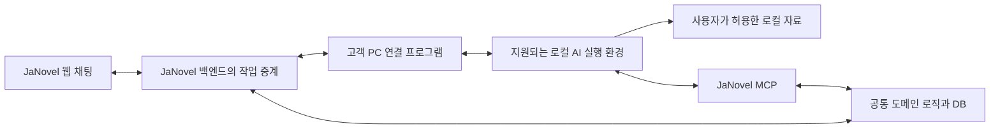

# 웹 내부 채팅과 고객 로컬 에이전트 연결 검토

2026-11-08 · 공식 문서 및 설치된 CLI 도움말 확인 · 설계 권고, 구현·인증·추론 실행 전

작업 순서 변경: 사용자는 이후 디자인 검토를 먼저 마무리하도록 지시했다. 아래 연결 실험은 디자인 검토 다음의 후속 작업이며 이번 Figma 작업에서 실행하지 않는다. [현재 디자인 범위](../design/14-core-screens-and-review.md)

## 결론과 결정 상태

고객의 로컬 자료를 참고하는 AI를 JaNovel 웹 채팅에서 사용하는 경험은 지원되는 실행 인터페이스를 통해 구성할 수 있다. 중간 서버에 MCP와 작업 중계 기능을 함께 두는 것도 가능하다. 다만 MCP 엔드포인트 등록만으로 기존 ChatGPT Work 앱을 원격 실행하거나 그 앱의 기억을 가져오는 기능이 생기지는 않는다.

사용자 확정 요구는 **웹 내부 채팅, 고객의 AI 이용 경로, 허용된 로컬 자료 활용, 서비스의 결과·버전 정리**다. 아래 구조와 Codex 우선 검증은 이번 검토의 권고이며 사용자 확정 기술 스택으로 기록하지 않는다. 제품화 이용 자격과 실제 실행 성공은 미검증이다.

## 중간 서버가 할 수 있는 일

| 역할 | 필요한 기능 | 판단 |
| --- | --- | --- |
| JaNovel MCP | 선택한 공고·문항·스냅샷·피드백 기준 조회, 수정 후보 반환 | 적합. 웹 API와 동일한 권한·도메인 로직 사용 |
| 작업 중계 | 웹 메시지를 고객 기기에 전달, 응답 스트림·중단·연결 상태 전달 | 필요. MCP 자료 조회와 별도로 설계 |
| 고객 PC 연결 프로그램 | 지원되는 에이전트 실행, 세션 연결, 로컬 접근·승인 처리 | 현재 요구를 위한 우선 검증 후보 |
| AI 실행 인터페이스 | 실제 모델 요청, 도구 실행, 대화 진행 | 에이전트별 지원과 계정 자격 확인 필요 |

MCP의 도구로 `run_agent` 같은 기능을 직접 만드는 것도 가능하다. 이 경우에도 그 도구 뒤에서 에이전트를 실행할 연결 프로그램·세션·인증이 필요하다. 기능을 MCP로 감싸는 것만으로 이 부분이 대체되지는 않는다. 이는 프로토콜 역할에 근거한 설계 판단이다.

MCP Sampling은 서버가 클라이언트에 생성을 요청하던 기능이지만, 2026-07-28 명세에서 사용 중단 예정으로 지정되어 신규 설계에 권장되지 않는다. 해당 개정은 서버발 요청 전달 방식도 MRTR로 변경했다. 따라서 Sampling을 웹에서 개인 ChatGPT를 호출하는 핵심 경로로 채택하지 않는다. 구형 규격에서 기능이 존재한다는 사실과 특정 호스트의 지원 여부도 구분한다. [MCP 공식 개정 안내](https://blog.modelcontextprotocol.io/posts/2026-07-28/)

## 권고 구성

이 그림은 제안 구조이며 실행 검증 결과가 아니다. 백엔드 작업 중계와 MCP는 처음에는 **같은 애플리케이션·배포 단위**에 둔다. 내부 웹 요청에 MCP를 의무적으로 한 번 더 거치게 하지 않는다. 고객 PC 연결 프로그램은 실행 위치가 달라 별도 프로세스가 필요하지만, 이것만으로 서버 전체를 MSA로 설계할 필요는 없다.

연결 프로그램이 서버로 인증된 연결을 시작하고 작업·이벤트를 주고받는 방식을 우선 검토한다. 고객 PC를 공개 서버처럼 노출하는 방식을 기본으로 삼지 않는다. 연결 수단과 재연결 방식은 작은 검증에서 정하며 지금 범용 중계 플랫폼을 만들지 않는다.

작업 흐름은 다음과 같다.

1. 사용자가 PC 연결 프로그램에서 AI 이용 경로와 참고할 자료 폴더를 지정한다.
2. 웹에서 선택한 공고·문항·원본 버전에 대해 피드백을 요청한다. 작성 중 본문을 쓰면 그 시점의 본문과 식별값을 함께 고정한다.
3. 백엔드가 소유권을 확인하고 해당 기기에 작업을 전달한다. 연결 프로그램이 전용 대화 세션을 만들거나 재개한다.
4. 에이전트가 허용된 자료와 JaNovel 맥락을 참고한다. 도구가 필요하면 JaNovel MCP를 사용하고, 응답·상태는 웹 채팅으로 전달한다.
5. 결과는 원본 버전에 연결된 **수정 후보**로 남긴다. 사용자가 낱말·구절 차이를 확인한 뒤 스냅샷으로 채택한다. 응답 도착만으로 기존 글을 덮어쓰지 않는다.

## 실행 인터페이스 선택지

| 후보 | 장점 | 제약과 이번 판단 |
| --- | --- | --- |
| Codex app-server | 대화 세션, 스트리밍, 승인, 중단을 위한 공식 인터페이스 | 첫 개인용 검증 후보. 현재 공식 안내상 실험 단계로 운영 서비스 지원이 보장되지 않음 |
| ACP 지원 에이전트 | 클라이언트와 에이전트 간 대화·도구·승인을 위한 표준 | 여러 에이전트 확장 시 검토. 원하는 에이전트의 실제 지원·인증을 별도로 확인해야 함 |
| 직접 API와 로컬 도구 실행 | 내부 채팅과 자료 접근을 직접 구성 가능 | 고객 API 또는 서비스 API 비용·에이전트 실행 로직 관리가 필요. 후속 비교 대상 |

Codex 공식 문서는 기존 `codex mcp-server`가 제거되었으며 app-server는 자체 JSON-RPC 프로토콜이라고 안내한다. 오래된 MCP 실행 예제를 구현 근거로 사용하지 않는다. [Codex MCP 서버 변경](https://learn.chatgpt.com/docs/mcp-server)

ACP 역시 MCP와 역할을 나누며, 로컬 에이전트 프로세스와의 통신 및 UI로의 진행 알림을 설명한다. JaNovel에 적용 가능한 후보라는 것은 이 구조에 근거한 추론이며, 모든 개인 AI나 기존 ChatGPT 앱의 ACP 지원을 뜻하지 않는다. 범용 어댑터부터 만들지 않고 한 실행 경로부터 검증한다. [ACP 구조](https://agentclientprotocol.com/get-started/architecture)

## ChatGPT 구독과 기존 맥락

실행 인터페이스와 모델 이용 권한은 별개다. app-server 인증의 기존 로컬·오픈소스 사용과 상업·호스팅 제공을 구분해야 한다. 공식 문서는 후자의 기존 app-server 인증 사용을 허용하지 않는다고 명시한다. 현재 안내하는 Sign in with ChatGPT 경로를 검토하며, 기존 앱의 인증 토큰을 가져다 쓰는 방식으로 설계하지 않는다. 브라우저에서 app-server WebSocket에 직접 붙는 것을 확정 경로로 삼지 않고, PC 연결 프로그램과 stdio 사용을 우선 검토한다. [App Server 공식 안내](https://learn.chatgpt.com/docs/app-server)

Sign in with ChatGPT는 적격 Plus·Pro 사용자가 별도 승인으로 구독 사용량을 앱에서 이용할 수 있는 경로다. 기존 ChatGPT 대화나 계정 맥락에 접근하는 권한은 제공하지 않는다. **같은 사용자 계정으로 모델을 이용하는 것**과 **기존 개인 GPT의 기억을 그대로 사용하는 것**은 별개다. JaNovel용 세션에 필요한 경험 자료와 선호를 명시적으로 제공하는 경험으로 설계한다. 공개 호스팅·유료 제공에는 별도 접근 신청과 자격 확인이 필요하며, 고객 PC에서 일부를 실행한다는 이유만으로 예외라고 결론 내리지 않는다. [SIWC 개요](https://developers.openai.com/siwc/token-sharing-open-source) · [제공 조건](https://developers.openai.com/cookbook/articles/sign-in-with-chatgpt?site_locale=en)

SIWC와 app-server의 조합도 공식 예제가 있다. 구독 사용을 승인받은 토큰으로 Responses 요청을 구성하고 stdio로 대화를 제어한다. 모델 목록 반환은 실제 모델 이용 권한의 증명이 아니므로 최종 검증에는 성공한 추론 요청이 필요하다. [SIWC의 app-server 연결](https://developers.openai.com/siwc/token-sharing-open-source/codex-app-server)

해당 경로는 호스팅된 Responses MCP·커넥터와 로컬에서 실행하는 MCP 도구를 구분한다. 현재 프리뷰에서 호스팅된 MCP는 지원되지 않지만 로컬 도구 실행 경로는 안내되어 있다. 추후 음성 면접도 이 경로로 자동 지원된다고 약속하지 않는다. [SIWC 프리뷰 제한](https://developers.openai.com/siwc/token-sharing-open-source/preview-limitations)

## 제품 관점의 의문점

- **설치 부담:** 일반 취업 준비 사용자에게 연결 프로그램과 AI 계정 설정이 큰 진입 장벽일 수 있다. 첫 사용자 본인이 실제로 편리한지 확인하고, 제품화 시 설치 없는 API 방식과 비교한다. 내부 채팅 요구는 유지한다.
- **고객의 맥락:** 로컬 파일에 자료가 있다는 이유만으로 에이전트가 필요한 사실을 정확히 찾는 것은 아니다. 선택한 자료·사용한 근거·부족한 정보를 응답과 연결해 확인해야 한다.
- **자료 이동:** 로컬에서 파일을 읽더라도 필요한 내용은 모델 제공자에게 전송될 수 있다. 로컬 연결을 ‘파일 내용이 PC 밖으로 전혀 나가지 않는다’고 안내하지 않는다. JaNovel에는 후보·근거 표시용 발췌 등 사용자가 허용한 범위만 저장하는 정책을 설계한다.
- **비용:** MCP·로컬 실행 자체가 추론을 무료로 만들거나 토큰을 자동 절감하지 않는다. 기존 구독 한도와 서버 유지 비용이 남는다. 공고 전체·모든 버전·폴더 전체를 매 요청마다 보내는 방식은 피한다.
- **연결 의존:** 고객 PC가 꺼졌거나 연결 프로그램이 종료되면 실행할 수 없다. 웹에서 연결 상태와 실패를 알리고 글 작성·버전 조회는 계속 가능하게 해야 한다.

## 다음 검증의 범위와 통과 기준

먼저 **본인 PC, 한 에이전트, 허용 폴더 하나, 문항 하나**로 검증한다. 처음부터 공개 SaaS, 여러 에이전트, 모바일의 무인 실행을 포함하지 않는다. 다음은 후속 실험 제안이며 아직 실행하지 않았다.

| 순서 | 확인할 것 | 통과 기준 |
| --- | --- | --- |
| 1. 권한과 실행 | 개인용 제공 자격·인증 방식, 설치된 실행 환경의 실제 프로토콜 | 정식 인증 경로 확인. 프로세스 연결·초기화 성공을 추론 성공과 구분 |
| 2. 웹 채팅 | 한 메시지 전송, 응답 스트림, 추가 질문, 중단 | 웹 안에서 한 세션을 유지하고 완료·실패·중단을 구분 |
| 3. 로컬 자료 | 명확한 사실이 담긴 시험 자료 하나와 접근 제외 자료 | 허용 자료를 근거로 답하고 허용 밖 자료 접근은 제한. 폴더 지정 프롬프트만으로 접근 제어를 대체하지 않음 |
| 4. 버전 연결 | 문항·원본 버전·요청 ID를 결과에 연결 | 다른 문항에 적용되지 않으며 중복 응답을 중복 저장하지 않음. 요청 중 본문이 바뀌면 변경된 원문 기준으로 자동 적용하지 않음 |
| 5. 결과 채택 | 후보 반환, 낱말·구절 비교, 스냅샷 채택 | 사용자가 고른 결과만 별도 스냅샷으로 남고 원본 유지 |
| 6. 연결 종료 | PC 연결 해제·재연결·실패 처리 | 종료된 권한으로 새 작업 불가. 요청을 무조건 재실행해 중복 작업·사용량을 만들지 않음 |

이 실험에 성공해도 검증 결과는 해당 버전·계정·개인용 구성에 한정한다. 일반 고객 제공과 운영 적합성은 별도다. 실패하면 원인을 인증 자격, 실행 프로토콜, 로컬 접근, 응답 반환으로 나누어 기록하고 MCP 이름 변경만으로 해결했다고 처리하지 않는다.

## 이번 확인과 남은 것

- 공식 MCP·ACP·OpenAI 문서를 읽고 위 역할·제약을 확인했다.
- 설치된 `codex app-server --help`에서 stdio·Unix socket·WebSocket 실행 옵션을 확인했다. 프로세스 초기화나 모델 사용 가능 여부를 시험한 결과는 아니다.
- 새 서버·연결 프로그램·인증·모델 호출·제품 MCP는 구현하거나 실행하지 않았다. 추가 모델 사용료를 발생시키는 호출도 하지 않았다.
- 현재 산출물은 검토안이다. 개인용 연결 실험을 다음 작업으로 권고한다.

관련: [AI 채팅 선택지](04-ai-chat-options.md) · [제품 기획](01-product-plan.md)
